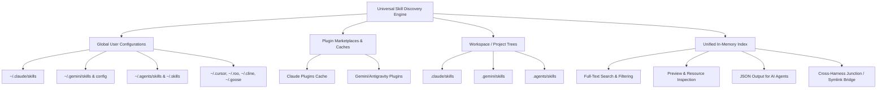

# Universal AI Agent Skill Discovery & Cross-Harness Retrieval Guide

> **A unified discovery engine and cross-harness bridge for AI agent skills** (.claude, .gemini, .agents, .cursor, .windsurf, .roo, .cline, .continue, .goose, .aider, .openhands, etc.).

---

## 1. Overview & Purpose

Modern AI coding agents (Claude Code, Google Antigravity / Gemini CLI, Cursor, Windsurf, Roo Code, Cline, Goose, Continue, etc.) have standardized modular capabilities around the **Agent Skills Specification** (directories containing `SKILL.md` with YAML frontmatter).

However, each agent installs or expects skills in distinct locations on the user's file system:
* Claude Code stores skills in `~/.claude/skills/` or plugin marketplaces.
* Gemini CLI / Antigravity stores skills in `~/.gemini/skills/` and `~/.gemini/config/plugins/`.
* Universal tools look for `~/.agents/skills/` or `.agents/skills/`.
* IDE agents like Cursor and Windsurf look in `.cursor/` or `.windsurf/`.

This tool suite **automatically discovers all installed harnesses**, indexes all available skills across personal, plugin, and workspace directories, and allows agents or users to **search, inspect, retrieve paths, and create instant zero-copy links** across harnesses without redownloading or duplicating files.

---

## 2. Architecture & Discovery Matrix



### Complete Harness Detection Map

| Harness ID | Agent / Tool | Vendor | Global User Paths | Plugin & Built-in Paths | Workspace (Project) Paths | Primary Rules / Instructions |
| :--- | :--- | :--- | :--- | :--- | :--- | :--- |
| `claude` | **Claude Code / Desktop** | Anthropic | `~/.claude/skills/`<br>`~/.config/claude/skills/` | `~/.claude/plugins/marketplaces/`<br>`~/.claude/plugins/cache/` | `.claude/skills/`<br>`.claude/plugins/` | `CLAUDE.md` |
| `gemini` | **Gemini CLI / Antigravity** | Google | `~/.gemini/skills/`<br>`~/.gemini/config/skills/` | `~/.gemini/config/plugins/*/skills/`<br>`builtin/skills/` | `.gemini/skills/`<br>`.gemini/plugins/` | `GEMINI.md`<br>`.gemini/config/rules/` |
| `agents` | **Universal Agent Standard** | Open Standard | `~/.agents/skills/`<br>`~/.skills/` | `~/.agents/plugins/*/skills/` | `.agents/skills/`<br>`.skills/` | `AGENTS.md`<br>`.agents/rules/` |
| `cursor` | **Cursor IDE** | Anysphere | `~/.cursor/skills/`<br>`~/.cursor/rules/` | — | `.cursor/skills/`<br>`.cursor/rules/` | `.cursorrules` / `.mdc` |
| `windsurf` | **Windsurf IDE** | Codeium | `~/.codeium/windsurf/skills/`<br>`~/.windsurf/skills/` | — | `.windsurf/skills/`<br>`.windsurf/rules/` | `.windsurfrules` |
| `roo` | **Roo Code (Roo Clinic)** | RooVeterinary | `~/.roo/skills/`<br>`Code/User/globalStorage/.../skills` | — | `.roo/skills/` | `.roomodes` |
| `cline` | **Cline** | Cline | `~/.cline/skills/`<br>`Code/User/globalStorage/.../skills` | — | `.cline/skills/` | `.clinerules` |
| `goose` | **Goose AI Agent** | Block | `~/.config/goose/skills/`<br>`~/.goose/skills/` | — | `.goose/skills/` | — |
| `continue` | **Continue.dev** | Continue | `~/.continue/prompts/`<br>`~/.continue/skills/` | — | `.continue/prompts/`<br>`.continue/skills/` | `.continue/rules/` |
| `aider` | **Aider** | Paul Gauthier | `~/.aider/prompts/`<br>`~/.aider/skills/` | — | `.aider/prompts/`<br>`.aider/skills/` | `.aider.conf.yml` |
| `openhands`| **OpenHands (OpenDevin)** | OpenHands | `~/.openhands/skills/` | — | `.openhands/skills/` | — |
| `copilot` | **GitHub Copilot** | GitHub | — | — | `.github/skills/`<br>`.copilot/skills/` | `.github/copilot-instructions.md` |
| `custom` | **Custom Environments** | User Config | `$AGENT_SKILLS_PATH` (colon/semicolon delimited) | — | — | — |

---

## 3. Included Scripts & Tool Suite

The tool suite consists of three complementary scripts in `D:\scripts`:

| Script | Runtime / Language | Description |
| :--- | :--- | :--- |
| **`skill_discovery.py`** | Python 3 (Standard Library only) | Core discovery, YAML parser, search engine, path retriever, and cross-harness linking engine. |
| **`skills.ps1`** | Windows PowerShell | Native PowerShell CLI wrapper with parameter support. |
| **`skills.sh`** | Bash / Shell | Unix / macOS / WSL / Git Bash wrapper. |

---

## 4. CLI Command Reference

### 1. Harness Discovery (`harnesses` / `env`)
Detects which AI agent harnesses are installed and active on the machine, reporting discovered skill counts:
```bash
python skill_discovery.py harnesses
# Or in PowerShell:
.\skills.ps1 harnesses
```
*Output:*
```text
=== Discovered AI Agent Harnesses ===

ID         Harness Name                     Vendor            Status       Skills Found
---------  -------------------------------  ----------------  -----------  ------------
claude     Claude Code / Desktop            Anthropic         [Active]     52 skill(s) 
gemini     Gemini CLI / Antigravity         Google            [Active]     15 skill(s) 
agents     Universal Agent Skills Standard  Open Standard     [Active]     19 skill(s) 
cursor     Cursor IDE                       Anysphere         [Not Found]  0 skills    
windsurf   Windsurf IDE                     Codeium           [Not Found]  0 skills    
roo        Roo Code (Roo Clinic)            RooVeterinaryInc  [Not Found]  0 skills    
cline      Cline                            Cline             [Not Found]  0 skills    
...
```

---

### 2. Listing Skills (`list` / `ls`)
Lists all discovered skills across all harnesses, showing scope (`global`, `plugin`, `builtin`, `workspace`), resources (`scripts`, `refs`, `assets`), and summary descriptions.
```bash
# List all skills across all harnesses
python skill_discovery.py list

# Filter by specific harness
python skill_discovery.py list --harness claude
python skill_discovery.py list --harness gemini

# Filter by scope
python skill_discovery.py list --scope global
python skill_discovery.py list --scope plugin

# Output only absolute paths to SKILL.md files
python skill_discovery.py list --paths-only
```

---

### 3. Searching Skills (`search` / `find`)
Performs weighted full-text search across skill names, tags, YAML descriptions, and frontmatter metadata:
```bash
# Search by keyword
python skill_discovery.py search frontend
python skill_discovery.py search audit

# Filter search inside a specific harness
python skill_discovery.py search "design" --harness claude
```

---

### 4. Fetching Exact Paths (`get` / `path`)
Returns the absolute path to a skill directory or its `SKILL.md` file (ideal for calling agents or scripts):
```bash
# Get skill directory path
python skill_discovery.py get humanizer
# Output: C:\Users\dell\.claude\skills\humanizer

# Get exact SKILL.md path
python skill_discovery.py get humanizer --file
# Output: C:\Users\dell\.claude\skills\humanizer\SKILL.md
```

---

### 5. Previewing Skill Instructions (`preview` / `show`)
Renders rich metadata, author info, version, sub-resources (`scripts/`, `references/`, `assets/`), and a preview of instructions:
```bash
# Preview first 25 lines of instructions + resources
python skill_discovery.py preview humanizer

# Preview full un-truncated instructions
python skill_discovery.py preview frontend-design --full
```

---

### 6. Zero-Copy Cross-Harness Linking (`link` / `install` / `share`)
Instantly shares a skill from one harness to another using **Directory Junctions (Windows)** or **Symlinks (Unix/macOS)** without duplicating files or re-downloading:
```bash
# Link 'humanizer' (installed in Claude) into Gemini CLI / Antigravity
python skill_discovery.py link humanizer --to gemini

# Link a skill into current project workspace (.agents/skills/)
python skill_discovery.py link frontend-design --to agents --project

# Force hard copy instead of symlink/junction (optional)
python skill_discovery.py link humanizer --to gemini --copy
```

---

### 7. Bulk Synchronization (`sync`)
Batch links all skills from a source harness into a destination harness:
```bash
# Bulk-sync all Claude skills into Gemini
python skill_discovery.py sync --from claude --to gemini

# Bulk-sync all Claude skills into current workspace (.agents/skills/)
python skill_discovery.py sync --from claude --to agents --project
```

---

## 5. Machine-Readable JSON Mode for AI Agents

All commands support the `--json` flag. When invoked by an AI agent (e.g. Gemini, Claude, Cursor, Roo Code), the tool outputs structured JSON for direct programmatic consumption.

### Example: `python skill_discovery.py get humanizer --json`
```json
{
  "id": "claude:humanizer",
  "name": "humanizer",
  "harness_id": "claude",
  "harness_name": "Claude Code / Desktop",
  "scope": "global",
  "description": "Remove signs of AI-generated writing from text. Use when editing or reviewing text to make it sound more natural and human-written. Based on Wikipedia's comprehensive \"Signs of AI writing\" guide...",
  "version": "2.7.0",
  "author": "",
  "tags": [],
  "path": "C:\\Users\\dell\\.claude\\skills\\humanizer",
  "skill_file": "C:\\Users\\dell\\.claude\\skills\\humanizer\\SKILL.md",
  "has_scripts": false,
  "scripts": [],
  "has_references": false,
  "references": [],
  "has_assets": false,
  "assets": [],
  "metadata": {
    "name": "humanizer",
    "version": "2.7.0",
    "description": "Remove signs of AI-generated writing from text...",
    "license": "MIT",
    "compatibility": "claude-code opencode",
    "allowed-tools": [
      "Read",
      "Write",
      "Edit",
      "Grep",
      "Glob",
      "AskUserQuestion"
    ]
  },
  "content_length": 31932
}
```

---

## 6. How AI Agents Integrate This in Automated Workflows

When an agent needs a specialized capability (e.g., frontend design, markdown linting, paper auditing, humanizing text) that might already be installed in another tool on the user's computer:

1. **Agent searches for existing skill:**
   ```bash
   python D:/scripts/skill_discovery.py search "audit" --json
   ```
2. **Agent inspects matching skills & tools:**
   ```bash
   python D:/scripts/skill_discovery.py preview "bib-audit" --json
   ```
3. **Agent loads instructions or links into current harness:**
   ```bash
   python D:/scripts/skill_discovery.py link "bib-audit" --to gemini
   ```
4. **Result:** Zero re-installation overhead, instant reuse of existing local customizations across all AI coding assistants.
